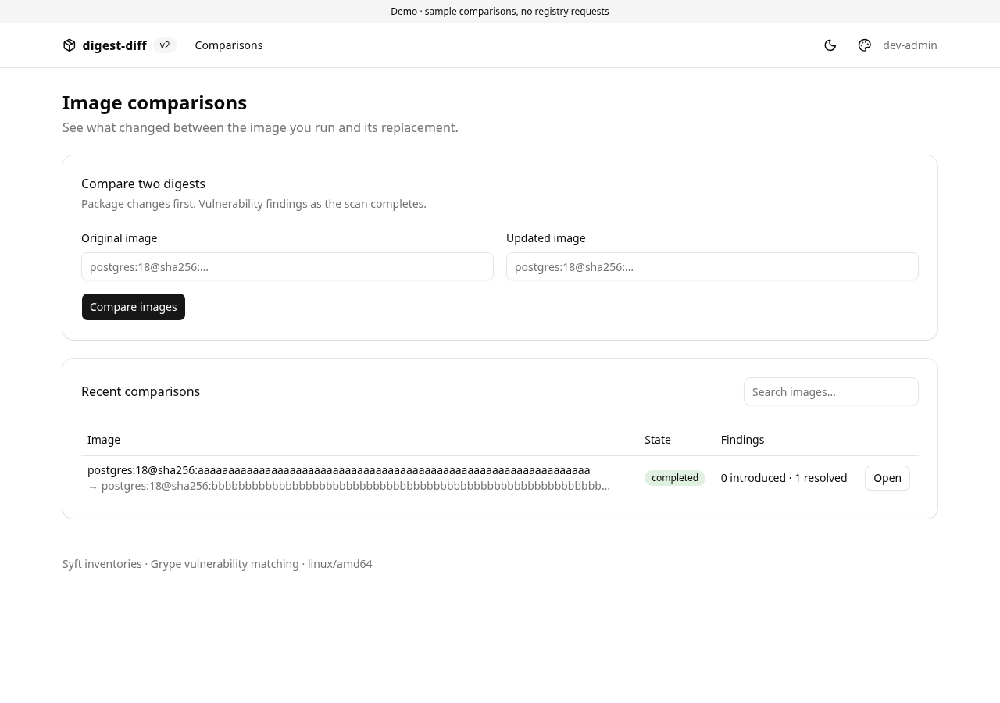
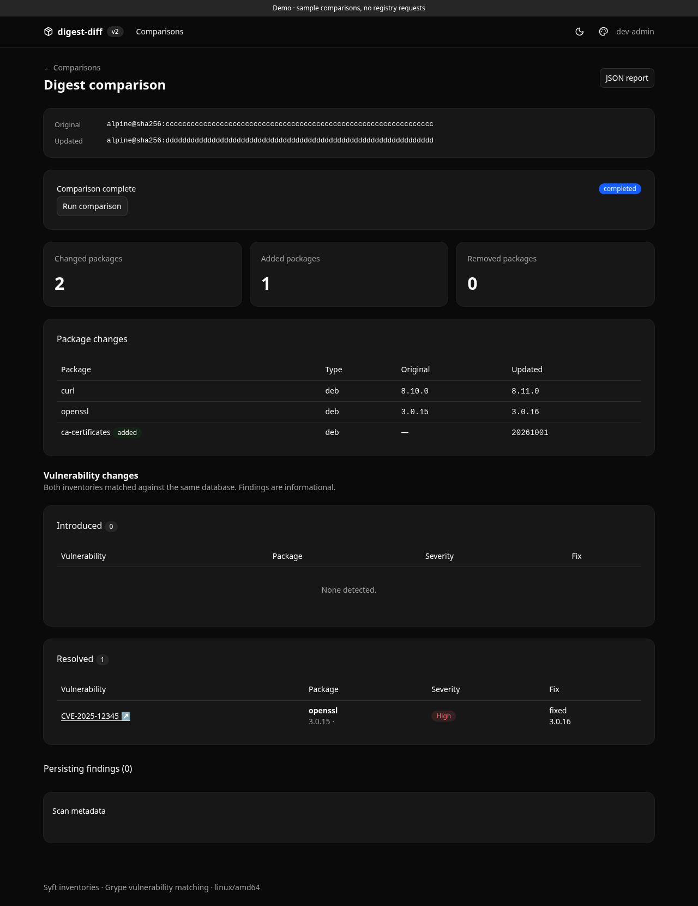
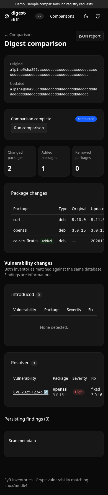
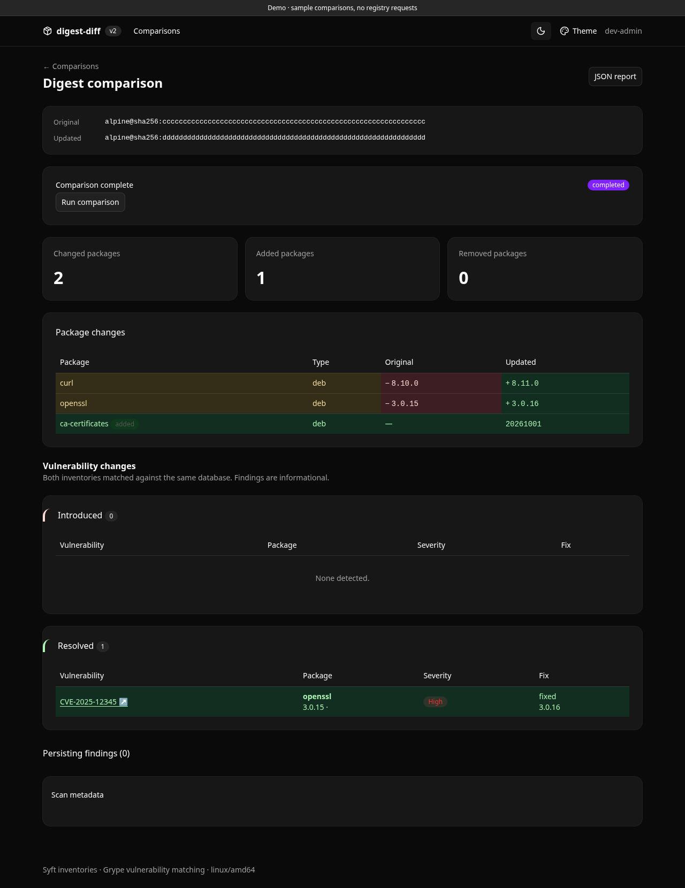

# digest-diff-2

A Rust/Axum version of digest-diff using the application foundations of
[clavium](https://github.com/PedDavid/clavium),
[dominium](https://github.com/PedDavid/dominium), and
[lastmile](https://github.com/PedDavid/lastmile).

Compare exact public image digests: package changes appear first, then introduced,
resolved and persisting vulnerability matches with advisory links. A searchable
recent comparison history (the latest 50 entries) survives restarts. Basecoat/Tailwind, Askama and htmx provide
the shared appearance, dark mode, accent palettes and progressive loading.



| Report in dark mode | On a phone |
|---|---|
|  |  |

The original Go service remains in `../digest-diff`; v2 has a separate image,
chart, data volume, configuration and release lifecycle. See
[FOUNDATIONS.md](docs/FOUNDATIONS.md) for source commits and architecture.

The **Theme** menu offers Minimal (neutral), Accent color (your selected palette),
and Full (git-style difference highlights). Full uses green/red for added/removed
packages and old/new version cells, amber for changed packages, red for introduced
vulnerabilities, and green for resolved findings. Persisting findings stay neutral.
The separate light/dark toggle works in every mode; settings persist in cookies.



## Try the UI

```sh
cd digest-diff-2
cargo run --locked -- --demo
```

Demo mode uses sample data and an in-memory database. It does not invoke Syft,
Grype, a registry or an identity provider. It permits administrative actions for
all visitors unless OIDC is configured. The UI is on port 8080, operations on 9090.

## Kubernetes

After the release workflow publishes the image and chart:

```sh
helm upgrade --install digest-diff-2 \
  oci://ghcr.io/peddavid/secops/charts/digest-diff-2 --version 0.1.1 \
  -n digest-diff-2 --create-namespace \
  --set publicUrl=https://digest-diff.example.com \
  --set oidc.issuer=https://auth.example.com/application/o/digest-diff/ \
  --set oidc.clientSecret.existingSecret=digest-diff-oidc \
  --set apiToken.existingSecret=digest-diff-renovate \
  --set serviceMonitor.enabled=true \
  --wait --timeout 5m
```

Or install the local `deploy/helm/digest-diff-2` directory. The chart requires an
OIDC issuer unless `demo` or `insecureDevAuth` is explicitly enabled. Register a
client named `digest-diff` with redirect URI `<publicUrl>/auth/callback`. Users in
`digest-diff-admins` can submit/retry comparisons; other authenticated users read.
Dotted group claims and userinfo/access-token fallback follow Lastmile's behavior.

Create Secrets securely in the release namespace:

| Secret | Key | Purpose |
|---|---|---|
| `digest-diff-oidc` | `client-secret` | OIDC client secret; optional for public clients |
| `digest-diff-renovate` | `token` | Random API bearer token, at least 32 characters |
| Optional existing cookie key | `cookie-key` | At least 64 raw bytes or base64; otherwise Helm generates one |

For GitOps, manage the cookie key as an existing Secret and set
`cookieKey.existingSecret`; this avoids random generated-key diffs during offline
Helm rendering. The generated cookie Secret is kept across upgrades/uninstall.
Use the corresponding configured values for existing OIDC/token Secret names.
No secret values are accepted in chart values or stored in application jobs.
Secret files are read at startup; roll out a restart after rotating them. Changing
the cookie key invalidates existing sessions.

[values.yaml](deploy/helm/digest-diff-2/values.yaml) covers storage, image tags or
digests, ingress, resources, authentication, scheduling and monitoring. Defaults:
Linux/amd64, one replica, Recreate strategy, a retained 10Gi ReadWriteOnce PVC,
read-only non-root container, writable temporary storage, no service-account token.
Set `persistence.storageClass` if there is no default StorageClass. Mount the same
PVC at `/data` across upgrades. Do not share it between deployments.

The UI Service exposes 8080 through port 80. Metrics and health checks are on a
separate, always ClusterIP Service named `<fullname>-metrics:9090`; do not expose
it through the UI ingress. ServiceMonitor, PrometheusRule and Grafana dashboard
are optional and require their respective monitoring installation.

## Moving from v1

Install v2 as a separate Helm release with a fresh PVC. V1's JSON cache is not a
v2 database and is not imported. Keep v1 running while you verify a real
comparison in v2, then switch Renovate's host and add its API bearer token.
Report query parameters stay compatible; previously generated v1 reports remain
on the old instance. V2's authenticated browser GETs do not start new jobs.

## Renovate/API

The endpoint paths remain `/jobs`, `/diff`, `/diff.json` and `/badge`; image query
parameters remain `old` and `new`, both `image@sha256:<64 lowercase hex>`.

```sh
# RENOVATE_DIGEST_DIFF_TOKEN is supplied securely to the caller.
curl --fail-with-body -X POST -G https://digest-diff.example.com/jobs \
  -H "Authorization: Bearer $RENOVATE_DIGEST_DIFF_TOKEN" \
  --data-urlencode "old=$OLD" --data-urlencode "new=$NEW"
```

Poll GET `/jobs` with the same authorization and query. Once `state` is
`completed`, GET `/diff.json` returns the report. Bearer-authenticated JSON requests
can also submit on a miss and wait for completion; API clients should prefer
asynchronous jobs to avoid proxy timeouts. The complete report retains the v1
`added`, `removed`, `changed`, `vulnerabilities` and `scan` fields.

Link a merge request to `/diff?old=...&new=...`; humans authenticate with OIDC.
Browsers submit with POST + Origin/CSRF, so a report GET does not enqueue work.
An unknown report offers a Run comparison button to administrators. Existing
jobs progressively poll htmx fragments and stop when completed or failed. A
failed vulnerability scan retains the already computed package report.

Badges are authenticated by default. Set `publicBadges=true` if GitLab/GitHub's
image proxy must fetch them anonymously; this reveals the queried job's summary
and state. Badges never enqueue jobs. A full queue returns 503 with Retry-After.
Session-based API POSTs still require admin rights and a CSRF header; machine
bearer tokens are exempt from browser Origin/CSRF checks.

Renovate's self-hosted administrator command allowlist remains necessary. Supply
the bearer token through its secure runtime environment, not an MR URL or a
repository configuration value. The normal Renovate post-upgrade job submission
and report link can use these endpoint paths after changing the host and auth.

## Scanner/cache behavior

Syft 1.54.1 and Grype 0.120.1 are pinned in the container and release downloads
are SHA-256 verified. Native SBOMs retain distro, locations and PURLs. Both sides
match against the same verified Grype database snapshot. Automatic database
updates are disabled while matching. Database TLS, download checksum, installed
hash and age validation stay enabled; failed database updates fail the job.

Inventories are retained by digest/platform/Syft version. Findings are keyed by
SBOM, Grype version, database identity and matching policy. Reports are reused
for `scan.ttl` (6h), then refreshed on submission. Changing scanner versions also
invalidates report freshness. Caches and job history have no automatic eviction
yet: monitor the PVC and back up SQLite if you need its history.

One worker runs comparisons with eight queue slots. `scan.timeout` (15m) begins
when a job starts, excluding queue wait. Timed-out child processes are killed.
On restart, pending jobs become failed/interrupted and can be retried. Completed
reports remain usable until stale. No scheduled monitoring, private registry
authentication, merge blocking, or ARM image support is included.

The deployment allowlists registries (default Docker Hub, GHCR, Quay, GCR and
MCR). Additional public registries must be set in `scan.allowedRegistries`.
The scanner uses registries directly, without a Docker socket. Egress HTTPS is
needed for allowed registries and their auth/layer endpoints and for
`grype.anchore.io`. OIDC discovery/token/JWKS/userinfo endpoints also need access.
The default network allowlist on a cloud task does not necessarily include these.

Counts represent package/advisory matches, not unique CVEs. Package versions
are compared as sorted sets. Vulnerability identity includes advisory namespace,
ID, package name and type; a vulnerable version change can persist. Distro or
advisory-namespace changes can appear as introduced/resolved findings even for
related CVEs. Resolved means no longer matched, not proof an image is safe.

## Development and releases

```sh
make check       # rustfmt, clippy -D warnings, unit/integration/OIDC tests
make helm-lint   # lint and render chart, including monitoring resources
make css         # optional Tailwind v4 standalone CLI; committed CSS builds offline
```

Rust is pinned by `rust-toolchain.toml`; Cargo.lock is committed. No Node.js is
required to build or run the application. The image includes scanner binaries;
a native non-demo run needs `syft` and `grype` on PATH and a writable data directory.
Flags have `DIGEST_DIFF_*` environment equivalents; `--help` lists them.

The dedicated workflow validates code and chart, builds the image, runs demo and real public-image
smoke tests before publishing to `ghcr.io/peddavid/secops/digest-diff-2`. It publishes
OCI charts under `ghcr.io/peddavid/secops/charts/digest-diff-2`. Semantic app and
chart versions are immutable: bump Cargo version and chart appVersion together
for an app release, and chart version for a chart release. Make new GHCR packages
public if your cluster pulls without registry credentials. `main` and full SHA
image tags are also published for development builds.

The Dockerfile accepts a BuildKit `proxy_ca` secret containing a trusted combined
CA bundle for network-restricted build environments. It is not retained in image
layers. Example: `docker build --secret id=proxy_ca,src=/path/to/ca-bundle.pem .`.
Normal public CI builds need no secret. Never disable TLS or checksum verification.
